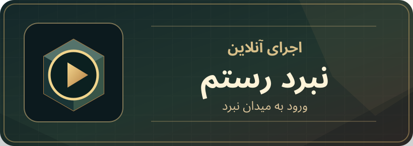

<h1 align="center">نبرد رستم</h1>

<p align="center">
  <a href="https://abolfazl2600.github.io/RostamBattle/" title="اجرای آنلاین بازی">
    
  </a>
  <a href="https://t.me/abolfazl_rezaiee" title="تلگرام سازنده">
    
  </a>
</p>

## دربارهٔ بازی

**نبرد رستم** یک بازی اکشن سه‌بعدی وکسل با الهام از حماسه‌های ایرانی است. فصل داستانی فعال فعلی، **«جنگ ایران و اشکبوس»** است و فصل‌های دیگر در منوی داستان با وضعیت «به‌زودی» نمایش داده می‌شوند. چالش‌ها و نبرد آزاد نیز در بازی قرار دارند.

## اجرا

برای اجرای نسخهٔ مرورگری از دکمهٔ «اجرای آنلاین» در بالای همین صفحه استفاده کنید. پیشرفت هر مرورگر به‌صورت محلی نگهداری می‌شود؛ پیش از پاک‌کردن داده‌های مرورگر به این نکته توجه کنید.

روی موبایل و تبلت، رابط بازی برای **حالت افقی (Landscape)** طراحی شده است. هنگام نگه‌داشتن دستگاه به‌صورت عمودی، سطح بازی به شکل نرم‌افزاری در همان حالت افقی نمایش داده می‌شود.

## راهنمای کنترل‌ها

| کار | صفحه‌کلید و ماوس | موبایل و تبلت |
|---|---|---|
| حرکت | W، A، S، D یا کلیدهای جهت‌دار | جوی‌استیک سمت چپ |
| دوربین | ماوس یا Q و E | کشیدن انگشت روی بخش خالی میدان |
| حمله | J یا کلیک چپ | دکمهٔ حمله |
| حملهٔ قدرتی | K یا کلیک راست | دکمهٔ قدرتی |
| پرش | Space | دکمهٔ پرش |
| جاخالی | L یا Shift | دکمهٔ جاخالی |
| یورش ویژه | I | دکمهٔ یورش پس از آماده‌شدن |
| تمرکز روی هدف | R | دکمهٔ هدف |
| توقف | Esc | دکمهٔ توقف |

راهنمای کامل کنترل‌ها، تنظیمات تصویر و انتخاب کیفیت گرافیکی از منوی اصلی بازی در دسترس هستند.

## زبان فارسی

منوها، راهنمای کنترل‌ها، متن‌های شخصیت‌ها، مأموریت‌ها، گفت‌وگوها، نتیجهٔ نبرد، اعلان‌ها و میان‌پرده‌های یورش به فارسی نمایش داده می‌شوند. برای خوانایی در رابط از قلم **وزیرمتن** استفاده شده است. شناسه‌های برنامه‌نویسی و متن‌های تاریخی موردنیاز برای سازگاری ذخیره‌ها ممکن است در فایل‌های منبع به زبان اصلی باقی بمانند، اما نباید در رابط بازی نمایش داده شوند.

## وضعیت نسخهٔ Android

پروژهٔ Android و فرایند ساخت APK در مخزن وجود دارند. بااین‌حال، **تأیید کامل روی دستگاه‌های واقعی هنوز انجام نشده** است؛ سازگاری لمس هم‌زمان، عملکرد، صدا و پایداری در اجرای طولانی باید پیش از اعلام پشتیبانی نهایی بررسی شوند. اطلاعات فنی و معیارهای تأیید در [راهنمای آزمایش موبایل](docs/MOBILE_QA.md) و [مستندات Android](docs/android/) آمده‌اند.

## توسعه و بررسی

برای اجرای بررسی‌های موجود پروژه به Node.js مطابق فایل `.nvmrc` نیاز دارید:

```bash
npm ci
npm run check:build
npm run check:game
```

این بررسی‌ها جای آزمایش روی گوشی یا تبلت واقعی را نمی‌گیرند.
